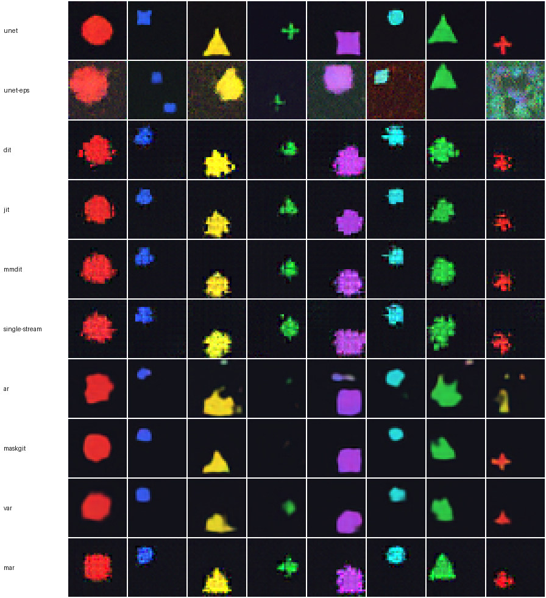

# tiny-text2image

**Twelve modern text-to-image architectures (plus an ε-prediction ablation), written from scratch, small enough to train and compare on a laptop CPU.**

`tiny-text2image` implements today's main text-to-image architectures side by side, from the
Stable Diffusion U-Net to FLUX-style MMDiT, one-step MeanFlow, Transfusion-style unified
models, VAR's next-scale prediction and MAR's continuous-token autoregression. All of them
share the same data, text tokenizer, training loop and automatic evaluation, so the *only* thing that differs is the architecture.

| family | models |
|---|---|
| **Diffusion / flow matching** | `unet` (Stable Diffusion U-Net, v-prediction; `unet-eps` ablation) · `dit` (DiT / PixArt-α) · `jit` (JiT pixel x-prediction) · `mmdit` (SD3 / FLUX double-stream) · `single-stream` (FLUX single blocks / Z-Image S3-DiT) · `sana` (SANA linear attention) |
| **One-step & unified** | `meanflow` (MeanFlow, one network evaluation) · `transfusion` (one transformer = LM + denoiser) |
| **Autoregressive / masked tokens** | `ar` (DALL-E / Parti / LlamaGen) · `maskgit` (MaskGIT / Muse) · `var` (VAR next-scale) · `mar` (MAR + flow head, NextStep-1 style) |

See [docs/architectures.md](docs/architectures.md) for the survey of the field (2025-2026),
the reasoning behind this selection, and exactly where each idea lives in the code.

## Results

Every model was trained for **2,000 steps at batch size 32 on a CPU** (no GPU), then asked to
draw 128 random prompts. The oracle scores each generated image (see below):

| model | family | trainable params | color | shape | position | size | all 4 correct | train time (CPU) | sampling / image |
|---|---|---|---|---|---|---|---|---|---|
| `unet` | diffusion (DDPM) | 1.17M | 100% | 100% | 100% | 100% | **100%** | 77 min | 781 ms |
| `unet-eps` | diffusion (DDPM) | 1.17M | 62% | 38% | 11% | 60% | **3%** | 72 min | 2659 ms |
| `dit` | flow matching | 0.95M | 100% | 32% | 100% | 90% | **25%** | 37 min | 113 ms |
| `jit` | flow matching (x-prediction) | 0.95M | 100% | 50% | 100% | 100% | **50%** | 23 min | 111 ms |
| `mmdit` | flow matching | 1.34M | 100% | 34% | 100% | 98% | **34%** | 37 min | 119 ms |
| `single-stream` | flow matching | 0.68M | 100% | 30% | 100% | 88% | **23%** | 20 min | 121 ms |
| `sana` | flow matching (linear-attention DiT) | 0.76M | 87% | 39% | 11% | 89% | **4%** | 27 min | 435 ms |
| `meanflow` | flow matching, one-step (average velocity) | 0.98M | 100% | 31% | 100% | 89% | **25%** | 64 min | 9 ms |
| `transfusion` | unified LM + flow matching (one transformer) | 0.64M | 100% | 41% | 100% | 100% | **41%** | 40 min | 153 ms |
| `ar` | autoregressive (discrete, next-token) | 0.54M | 83% | 47% | 80% | 86% | **30%** | 14 min | 101 ms |
| `maskgit` | masked generative (discrete) | 0.69M | 91% | 84% | 100% | 100% | **77%** | 15 min | 40 ms |
| `var` | autoregressive (discrete, next-scale) | 0.69M | 92% | 72% | 97% | 97% | **65%** | 23 min | 15 ms |
| `mar` | masked autoregressive (continuous, diffusion/flow head) | 0.87M | 100% | 73% | 100% | 98% | **72%** | 46 min | 241 ms |
| *real images (oracle ceiling)* | - | - | 100% | 100% | 100% | 100% | **100%** | - | - |

<p align="center"></p>

*Columns of the grid, left to right:* “a large red circle at the center” · “a small blue square at the top left” · “a large yellow triangle at the bottom” · “a small green cross at the right” · “a large purple square at the bottom right” · “a small cyan circle at the top” · “a large green triangle at the left” · “a small red cross at the bottom left”.
Per-model 4-sample grids are in [`results/`](results/); tokenizer reconstructions in
[`results/reconstructions_vq.png`](results/reconstructions_vq.png) and [`results/reconstructions_msvq.png`](results/reconstructions_msvq.png).

**What the numbers say** (at this tiny scale and budget):

* **Every architecture learns text conditioning.** All models but SANA get colour and position at 80-100%
  (random guessing: 17% and 11%).
* **The convolutional U-Net with v-prediction wins at this scale: 100%.** Convolutions have exactly the right
  inductive bias for small, pixel-exact shapes; it is the only model that draws the small crosses crisply.
  Transformers trade that bias for scalability, which pays off far beyond this toy.
* **The prediction target is decisive.** `unet` and `unet-eps` are the *same network* trained the same way; only the
  regression target differs. ε-prediction (DDPM / SD 1.x) scores 3%: near pure noise, recovering x₀ from ε divides by
  √ᾱ ≈ 0, so small errors explode exactly where the layout is decided, and position falls to chance (11%).
  Lowering guidance makes it worse (0-3%), ruling out over-guidance. v-prediction (SD 2.x) scores 100%.
  Likewise JiT vs DiT (one network, two targets): predicting the clean image doubles 25% → 50%, in line with
  *Back to Basics* (Li & He, 2025).
* **MeanFlow makes sampling ~40× cheaper.** Same DiT backbone, but it learns the *average* velocity: one network
  evaluation (2 ms) matches DiT's 30-step score (25%), and 2 steps already beat it:

  | MeanFlow steps | 1 | 2 | 4 | 8 | *DiT, 30 steps* |
  |---|---|---|---|---|---|
  | all correct | 25% | 35% | 34% | 37% | *25%* |

* **Transfusion: one transformer is both the caption LM and the denoiser** (41%, and it writes grammatical captions:
  `"a small blue"` → `"a small blue square at the top right"`). Its patchify matters: with a plain linear patchify
  images fell apart into independent patches; the paper's small U-Net down/up blocks (now the default) fixed it.
* **Token models are the strongest transformers at equal steps.** The VQ decoder handles fine detail, so the
  transformer only picks 64 codes: MaskGIT (77%), MAR (72%), VAR (65%). VAR samples fastest among them.
* **SANA's NoPE design needs depth.** With no positional embedding, tokens must infer absolute position through the
  zero-padding of the depthwise convolutions; with only 4 blocks on an 8×8 grid, position stays at chance (11%).
  SANA relies on 20+ blocks for this to work; linear attention itself is verified exact in the tests.
* **Pixel-space flow transformers get layout right but blur shapes** at 2,000 steps (DiT, MMDiT, single-stream).

> Caveats: train and sampling times are wall-clock on a CPU shared with other heavy jobs, so compare
> them within the table only. Scores at n=128 carry about ±4% standard error, and most of these models
> have not converged. Rankings at real scale (billions of parameters, VAE latents, long training) differ:
> MMDiT and single-stream DiTs power most current production systems. "Trainable params" excludes the
> frozen VQ tokenizer of `ar`, `maskgit` and `var`. All multi-step models use guidance scale 3.0;
> MeanFlow learns guidance during training and samples with 1.0.


## The toy task: captioned shapes

Every image is one coloured shape on a dark background, rendered procedurally at 32×32:

```
"a {small|large} {red|green|blue|yellow|purple|cyan} {circle|square|triangle|cross}
 at the {top left|top|top right|left|center|right|bottom left|bottom|bottom right}"
```

That gives 432 prompts with 4 independent attributes, plus random jitter in position and scale.
It is simple enough to learn on a CPU in minutes, yet a model only scores well if it binds
**every** word to the right visual property.

**Evaluation without humans.** Because the ground truth is known, a small CNN "oracle"
(`text2image/evaluate.py`) is trained to read colour, shape, position and size from real images
(≈100% accurate). We run it on generated images and report per-attribute accuracy and the
fraction of images with **all four attributes correct**: a toy analogue of GenEval.

## Quick start

```bash
uv venv && uv pip install torch --index-url https://download.pytorch.org/whl/cpu
uv pip install -e ".[dev]"
pytest -q                      # 44 tests: shapes, gradients, sampling, tokenizers, JVP, masks, overfitting

# full pipeline: oracle -> tokenizers -> 9 models -> evaluation -> results/
bash scripts/run_all.sh
```

Or one model at a time:

```bash
text2image-train oracle --out runs/oracle
text2image-train mmdit  --out runs/mmdit
text2image-train vq     --out runs/vq
text2image-train maskgit --tokenizer runs/vq/model.pt --out runs/maskgit

text2image-sample --ckpt runs/mmdit/model.pt -n 8 --out red.png \
    --prompt "a large red circle at the top left"
text2image-eval --ckpt runs/mmdit/model.pt --oracle runs/oracle/model.pt --n 256
```

Model sizes are a CPU preset (~1M parameters). On a GPU, scale up any model with
`--set`, e.g. `text2image-train dit --set dim=384 depth=12 heads=6 --steps 50000 --batch-size 256`.

## Repository layout

```
src/text2image/
├── data/shapes.py          synthetic captioned-shapes dataset (pre-rendered jitter bank)
├── text/                   word tokenizer + small transformer text encoder (CLIP/T5 stand-in)
├── nn/layers.py            attention, adaLN modulation, timestep embedding, patchify, ResBlock
├── generation/             DDPM schedule + DDIM sampler, rectified-flow utilities + Euler sampler
├── tokenizers/vq.py        VQ-VAE with single-scale or VAR multi-scale residual quantizer
├── models/
│   ├── base.py             T2IModel / FlowModel / VQModel interfaces, classifier-free guidance
│   ├── unet.py             U-Net + DDPM (Stable Diffusion lineage)
│   ├── dit.py              DiT (PixArt-α cross-attention) and JiT (x-prediction)
│   ├── mmdit.py            MMDiT (SD3 / FLUX double-stream)
│   ├── single_stream.py    single-stream DiT (FLUX single blocks / Z-Image)
│   ├── sana.py             linear-attention DiT with Mix-FFN and NoPE (SANA)
│   ├── meanflow.py         one-step generation via the average velocity (MeanFlow)
│   ├── transfusion.py      one transformer as both caption LM and image denoiser
│   ├── autoregressive.py   next-token AR over VQ codes
│   ├── maskgit.py          masked generative transformer
│   ├── var.py              next-scale prediction
│   └── mar.py              masked AR with continuous tokens + flow head
├── registry.py             model zoo: default sizes, training recipes, checkpoint I/O
├── train.py / sample.py / evaluate.py   CLIs
scripts/run_all.sh          end-to-end benchmark, scripts/make_report.py builds results/
tests/                      unit tests for every component
docs/architectures.md       literature survey and design notes
```

Every model implements the same two methods, which keeps the code easy to compare:

```python
loss = model.loss(images, tokens)                  # training objective
images = model.generate(tokens, cfg_scale=3.0)     # sampling with classifier-free guidance
```

## License

MIT
